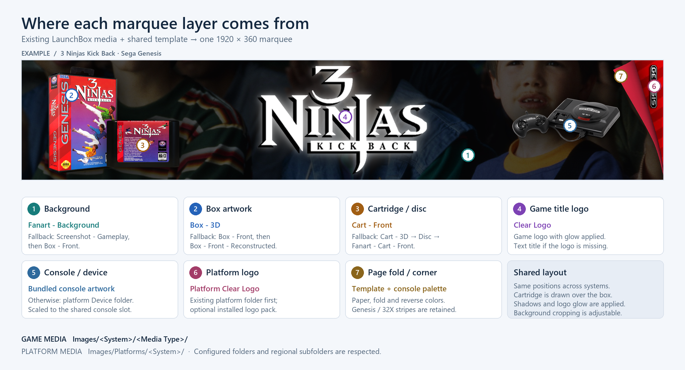
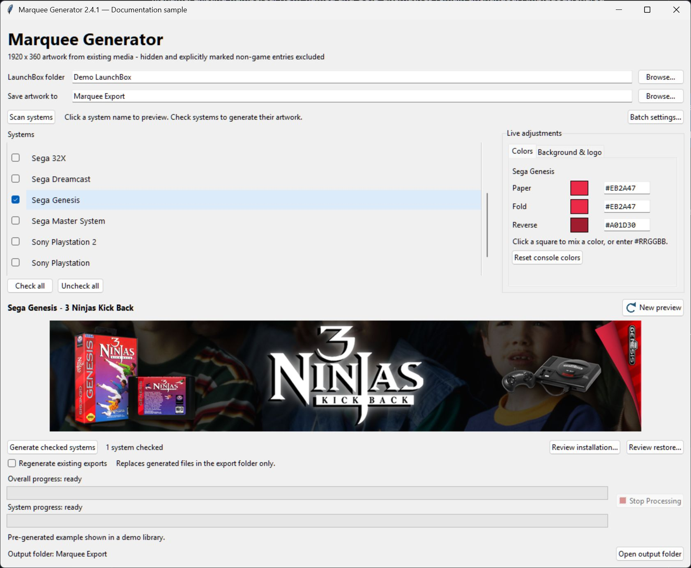

# LaunchBox Marquee Generator

Current version: **2.4.1**

Create 1920 x 360 PNG marquees from your existing LaunchBox artwork. No AI generation or online media service is used.

Version 2.4.1 moves **New preview** beside the preview title and keeps both progress bars visible at all times. Independent preview focus, generation checkboxes, numbered installation preservation, live controls and recovery remain available.

## Template and image sources

The numbered sample below shows how existing media fills the shared template. The annotation numbers are documentation only; generated marquees remain **1920 × 360**.



[View the original sample without annotations](docs/images/sample-marquee.png).

| # | Template layer | Source and fallback order |
| --- | --- | --- |
| 1 | Background | `Fanart - Background` → `Screenshot - Gameplay` → `Box - Front`. The global crop adjustment controls which part is visible. |
| 2 | Box artwork | `Box - 3D` → `Box - Front` → `Box - Front - Reconstructed`. |
| 3 | Cartridge / disc | `Cart - Front` → `Cart - 3D` → `Disc` → `Fanart - Cart - Front`. This layer is drawn over the box. |
| 4 | Game title logo | `Clear Logo`, with the template's glow applied. A text title is used when no logo or template fallback is available. |
| 5 | Console / device | The console artwork assigned by the bundled profile in `assets/`. Profiles without a bundled console image use `Images/Platforms/<System>/Device/`. |
| 6 | Platform logo | In Automatic mode, `Images/Platforms/<System>/Clear Logo/` first, then installed platform-logo packs. An explicitly selected pack can take priority. |
| 7 | Page fold / corner | Bundled template components plus the console's Paper, Fold, and Reverse palette. Original Genesis/32X corner stripes are retained. |

Game media normally lives under `Images/<System>/<Media Type>/`. The generator also respects LaunchBox's configured media folders, regional subfolders, and Scrape As aliases for platform logos. Shadows, glow, scaling, and the fold are applied by the template rather than scraped as separate game images.

## Application UI

The actual application below displays a pre-generated sample in a **demo library**, with example paths rather than personal locations. It shows system checkboxes, independent preview focus, the color controls, **New preview** outside the artwork, and both progress bars.



## Start and preview

1. Download this repository using **Code → Download ZIP**, then extract the **complete** program folder. Keep `assets`, `profiles.json`, and all Python modules together.
2. Double-click **Start Marquee Generator.cmd**.
3. Browse to the LaunchBox installation containing `Data` and `Images`, and choose an export folder **outside LaunchBox**.
4. Click **Scan systems**. Click a **system name** to preview/edit that console, and use the **checkboxes** to include systems in generation. Preview focus and checked systems are independent; the highlighted name identifies the console being previewed. The first checkbox can supply the initial preview when none is focused.
5. Use **Colors** for paper, fold and reverse colors. Click a square for the live picker or enter six HEX digits beside it.
6. Use **Background & logo** for global background crop, the game-title filter and console-logo source. Crop is 0% top, 50% center and 100% bottom.
7. Click **New preview**, beside the title above the image, to load another random game from the focused console. Hover/focus shows its explanation. Color/crop edits retain the current game. Preview and palette editing work even when no systems are checked.
8. Check systems and click **Generate checked systems** below the preview. The adjacent count shows how many systems will run; Generate is disabled with none checked. **Check all / Uncheck all** affect batch choices without clearing the preview.
9. Use **Regenerate existing exports** beside the generation controls only when existing exported files should be rebuilt. Its explanation refers to generated files in the export folder; it does not directly replace installed LaunchBox images.
10. During a batch, **Overall** and **current-system** bars retain their own counts/percentages above each bar. The status below them shows **Now generating: System - Game** before that game's artwork lookup/render starts. **Stop Processing**, with a square stop icon to the right of both bars, finishes the current game and saves progress before stopping.
11. Use **Review installation** to inspect the generated replacements and numbered preservation plan, then choose a backup location and install. The footer always shows only the current output folder, with **Open output folder** beside it. The generated `copy-map.csv` remains available as an advanced/manual-copy report; the reviewed installer does not require you to read it.

A live preview writes no artwork files. It uses a moving progress indicator while finding assets/rendering. Batch preparation also uses the moving overall indicator while counting eligible games. The system bar remains visible at zero with a waiting label during preview/preparation, and both bars show ready labels when idle. Once counted, two bars show **overall games processed** and **games processed in the current system**, with percentages and counts. Unchanged, verified, shared-name, and failed attempts count as processed work; the error count/report distinguishes success from completion. Hidden/excluded games and games beyond a title filter or limit do not count. Stop retains the actual percentage rather than showing 100%.

Folder selections, accepted palette choices, custom swatches, crop, per-console logo preferences, and batch/memory settings are saved in `settings.json`. Rapid edits are combined before an atomic preference save, and closing the app flushes accepted changes. Keep the program folder writable. Copy an older `settings.json` into this extracted folder to retain your preferences.

## Live color picker

Click a square to open a Paint-style picker. Drag in the color area, move the rainbow hue slider, enter RGB values from 0 to 255, or type a six-digit HEX color. The original and new squares show the change, and the marquee updates while the dialog stays open. The color area supports arrow keys.

**Apply** keeps the color and remembers it among 12 custom swatches. **Cancel**, Escape, or closing the picker restores the complete original console palette, including linked fold shades. Draft colors are not saved. **Reset console colors** restores the selected system's bundled palette without changing games.

Paper updates both coordinated fold shades; editing Fold updates Reverse; Reverse can be adjusted independently. Incomplete or invalid HEX input is highlighted and blocks preview/export until corrected. HEX accepts six digits with or without `#` and displays uppercase letters.

## Reviewed installation and numbered preservation

1. Generate or verify the desired export with version 2.1 or later. Existing exports are adopted only after an exact comparison with the current renderer. Dimensions alone never establish provenance.
2. Check the systems to install, or uncheck all to review all verified systems. Click **Review installation**. Review alone changes no artwork.
3. Inspect the selected rows and paths. The review shows each old unnumbered image and its proposed numbered filename. Existing numbered, ROM-named and GUID alternatives remain unchanged. Ambiguous/shared ownership is blocked for manual review.
4. Click **Choose backup folder**. Choose a location outside LaunchBox and the installed/generated marquee folders. A fresh location choice is required for each installation.
5. Close LaunchBox and Big Box, then click **Back up and install selected**. All displaced originals are copied and hash-verified in a dated backup folder before any rename. The originals are renamed in their current folders, preserving their image extensions and bytes. The generated image is then copied to its unnumbered title filename.
6. Refresh the affected game's images in LaunchBox after installation.

For example, with these existing images:

```text
Super Mario Bros.png
Super Mario Bros-01.png
Super Mario Bros-02.png
```

Installation renames the existing **`Super Mario Bros.png` → `Super Mario Bros-03.png`**, then installs the generated image as **`Super Mario Bros.png`**. The existing `-01` and `-02` files are untouched. No existing artwork is deleted or relocated, and no new `.disabled` files are created.

Numbering appends after the highest existing number; gaps are not filled. With `-01` and `-03`, the next number is `-04`. Numbers are compared case-insensitively across supported image formats in the same folder; an existing `-02.jpg` reserves number 2 when preserving a PNG. A JPEG original retains `.jpg`. Numbers grow beyond 99, and filenames created after review are never overwritten. An already-installed matching generated image is skipped, even when numbered alternatives remain.

Only unnumbered images with the canonical title stem are displaced, including such images in configured regional subfolders. Other numbered/ROM/GUID alternatives are retained. Each affected directory has its own sequence. Unique ordinary titles install under their normalized unnumbered name; duplicates/path-shortened titles retain GUID disambiguation. Exports retain their established `-01.png` convention.

Both numbered and unnumbered names are valid LaunchBox matches. The published [community matching tests](https://forums.launchbox-app.com/topic/33272-fyi-media-file-naming/page/3/) do not guarantee that unnumbered images always take precedence. Numbered alternatives remain available to LaunchBox under this requested preservation policy.

The assistant only examines the current configured **Arcade - Marquee** folders. Unrecognized files, unconfigured `(large)` folders, Banner/Steam Banner artwork, ROMs and LaunchBox metadata are untouched. Redirected paths, altered exports, ambiguous matches, changed reviews and overlapping writers are blocked. Review is rebuilt immediately before installation, including number allocation, so newly added matching files require a fresh review.

### Restore originals

Click **Review restore** and choose the dated folder containing `restore-manifest.json`. The review shows where the unchanged generated image will be preserved using the next available numbered filename. Click **Restore selected images** to preserve it in place and reactivate the original unnumbered filenames. Existing numbered alternatives remain unchanged. If a preserved original was removed externally, its verified external backup can recover it. Edited originals/generated images are conflicts and are not overwritten.

Restore supports interrupted installs/restores and repeated cycles. Its journal records the approved number before any rename. Keep the entire dated backup folder; it stores original bytes in short numbered backup files and maps them to the original/preserved paths. Version 2.1 and 2.2 backup journals remain supported with their earlier restore semantics; new 2.3 installations use numbered preservation.

**Generation writes only to the export folder. Installation/restore write to LaunchBox only after their separate reviewed action is selected.**

## Export files and repeat runs

Standard export layout:

```text
Chosen export folder/
  Images/<system>/Arcade - Marquee/Game Title-01.png
  media-report.csv
  excluded-games.csv
  copy-map.csv
  marquee-state.json
  marquee-checkpoint.json
  marquee-manifest.json
```

For manual installation, merge the export's **Images** folder into the selected LaunchBox installation. Copy the images, not the reports/state files. Back up existing custom art first. Older alternatives are not removed by copying or by Rebuild. Use the reviewed installer to preserve displaced unnumbered title images as numbered alternatives.

Custom relative marquee folder overrides from `Data/Platforms.xml` are mirrored, even if their destination has not been created. External destinations are staged under `External marquee folders/<system>/<folder name>`; `copy-map.csv` lists the actual destinations. The installer derives destinations from the current selected library rather than trusting an old destination string.

Normal filenames are `Game Title-01.png`. Apostrophes and Windows-invalid characters (`< > : " / \ | ? * '`) become underscores; a consecutive run becomes one underscore. `8 Eye's` therefore becomes **`8 Eye_s-01.png`**. Titles colliding after normalization retain their game IDs. Long/reserved titles and long output paths also retain a GUID when shortening is needed. Verified GUID-named exports remain identifiable after moving an export folder. Naming follows the community's [media matching tests](https://forums.launchbox-app.com/topic/33272-fyi-media-file-naming/page/3/).

- `media-report.csv`: current-run results, source paths, missing media/fallbacks, errors, output paths, and verified SHA-256 values.
- `excluded-games.csv`: hidden and explicitly marked non-game entries skipped in the selected systems/title filter.
- `copy-map.csv`: staged folder to configured destination mapping.
- `marquee-state.json`: compatible source/style signatures for incremental generation.
- `marquee-checkpoint.json`: authoritative atomic recovery snapshot and current counted progress.
- `marquee-manifest.json`: verified generated replacements and content hashes used by the review assistant. Keep it with the images if moving the export.

Existing unknown files that differ from the current expected render are retained unless **Regenerate existing exports** is selected. Previously verified files edited externally are also retained and excluded from verified installation until rebuilt/verified. UI-only version updates do not invalidate otherwise unchanged 1.9.1 rendering signatures. New source media or selected logo packs can legitimately change a render signature.

## Batch recovery and memory settings

Open **Batch settings**:

- **Save progress every (games)** defaults to 25. State/reports are also saved after a completed game when 30 seconds have passed, at system boundaries, and on Stop. The supported interval is 1-10000.
- **Artwork memory cache** defaults to 128 MB per cache. Batch/shared decoded sources and the current preview's decoded sources have separate limits.
- **Live preview memory cache** defaults to 64 MB for completed layers.

These values are implemented in MiB. Cache limits cover retained pixel buffers; temporary decoding/rendering buffers, metadata, and other Python/Tk memory are additional. An image larger than a cache limit still renders, but is not retained. Decrease the budgets to reduce retained memory; increase them if very large assets repeatedly need decoding. The app reuses unchanged preview layers without changing output pixels.

Resume a stopped/interrupted run by selecting the same export and settings and generating again. Completed verified files skip rendering. A PNG completed after the last durable checkpoint is adopted only after an exact comparison against a fresh render. State/report writes are atomic; incompatible or missing projections can be rebuilt from checkpointed state on the next run. OS-held locks prevent overlapping generators/installers for an export, and separate library locks serialize installations/restores from different exports. A crashed process releases its OS locks automatically.

## Media discovery and logo packs

Systems/imported games come from `Data/Platforms/*.xml`, excluding backup files. ROM paths are read, not opened or modified; unimported disk files are not added as games. Media is read from configured folders or standard `Images/<platform>/<media type>` folders, including regions. Game-specific filenames precede title/ROM/ID fallbacks; canonical title spellings precede legacy apostrophe/repeated-underscore source aliases. Ambiguous punctuation matches are reported rather than guessed.

On **Background & logo**, **Automatic (existing folder first)** preserves the first supported file in `Images/Platforms/<platform>/Clear Logo`. If missing, installed packs under `Images/Media Packs/Platform Clear Logos` are searched, preferring Nostalgic and legacy conversion packs before other packs. Select a pack explicitly to try it before the existing folder; missing logos fall back automatically. Custom platform names can use Scrape As aliases. Supported raster formats are PNG, JPEG, WebP, BMP, and TIFF; SVG is not decoded. No pack is downloaded or applied to LaunchBox itself. [LaunchBox pack guidance](https://feedback.launchbox-app.com/help/articles/1902408-creating-platform-clear-logo-media-packs-for-launchbox-and-big).

Preview loading reuses configured-folder resolution and console-logo discovery across random games until the next Scan. Automatic logo lookup stops at an existing per-console logo instead of scanning unused packs. Pack enumeration reuses directory-entry metadata, and byte-limited shared caches retain decoded templates and completed template layers between games. Game-dependent layers are isolated per preview context, so externally edited game art is reread on the next load. Template timestamps invalidate edited template layers. A first preview still requires media lookup/decoding/rendering; these changes primarily reduce repeated work.

Scan reloads profile data and clears discovery caches. Initial game lookup and logo changes run off the UI thread; color/crop changes reuse the current game's sources. Stale render results cannot replace newer edits.

## Which games are excluded

Both batch and random preview skip:

- LaunchBox entries with `<Hide>true</Hide>` (or its equivalent true value).
- Titles starting `ZZZ(notgame)`.
- Explicit `[BIOS]`, `[Device]`, `[DLC]`, or `[Update]` markers in the title, Version, or application filename, including parenthesized/case variants. Parent directory names alone do not exclude a game.

Ordinary words are not exclusion markers: *DLC Quest* remains eligible. Hide unmarked DLC/BIOS records in LaunchBox, save/close it, then Scan again. The generator uses the saved Hide flag, not every UI playlist/filter, and does not verify playability. Broken/uninstalled games are not automatically excluded unless they meet those rules.

## Layout, installation requirements, and portability

Artwork remains **1920 x 360**. Shared slots keep foreground placement consistent, trim transparent margins, preserve proportions, and draw cartridges over boxes. The paper silhouette contains the console logo/shadow. Coordinated reverse colors, contrast outlines, and Genesis/32X original striped corners are retained. `profiles.json` controls layout and bundled palettes. Pillow approximates CTC/WPF effects and is not pixel-identical to CTC.

Windows, Python 3.10+, tkinter, and Pillow are required. Run **Install Requirements.cmd** once on a PC needing Pillow. All application modules and assets are relative to the extracted folder. Choose your own local or accessible network LaunchBox and export paths, then click Scan systems. No development-machine paths are required. After dependency setup, the program needs no internet connection. Accessible network libraries are also supported without storing credentials.

Optional command line:

```text
python marquee.py --launchbox "D:\LaunchBox" --list
python marquee.py --launchbox "D:\LaunchBox" --output "D:\Marquee Export" --platform "Nintendo Entertainment System" --checkpoint-games 25 --image-cache-mb 128
python marquee.py --launchbox "D:\LaunchBox" --output "D:\Marquee Export" --logo-pack "Nostalgic Platform Clear Logos" --background-position 50
```

Repeat `--platform` to select systems; omit it for all. Use `--title`, `--limit`, and `--force` as needed. Command-line palette defaults come from `profiles.json`; GUI saved palette overrides are separate. Install/restore remain explicit reviewed GUI workflows.

## Validation and developer notes

117 automated checks cover rendering/layout, filename rules, filtering, region matching, cache budgets/pixel parity, live color controls, exact progress, stop/resume/crash recovery, manifest verification, installation/restore, conflict detection, changed reviews, shared images, source preservation, concurrency locks, and the real Tkinter workflows. All installation tests use disposable fixture libraries, not the user's actual arcade installation.

Run `python -m unittest discover -p "test_*.py"` from this folder. See **DEVELOPER.md** for architecture, callback contracts, schemas, and recovery invariants. Public APIs and the critical backup, cache, threading, and checkpoint code include maintenance docstrings/comments.
